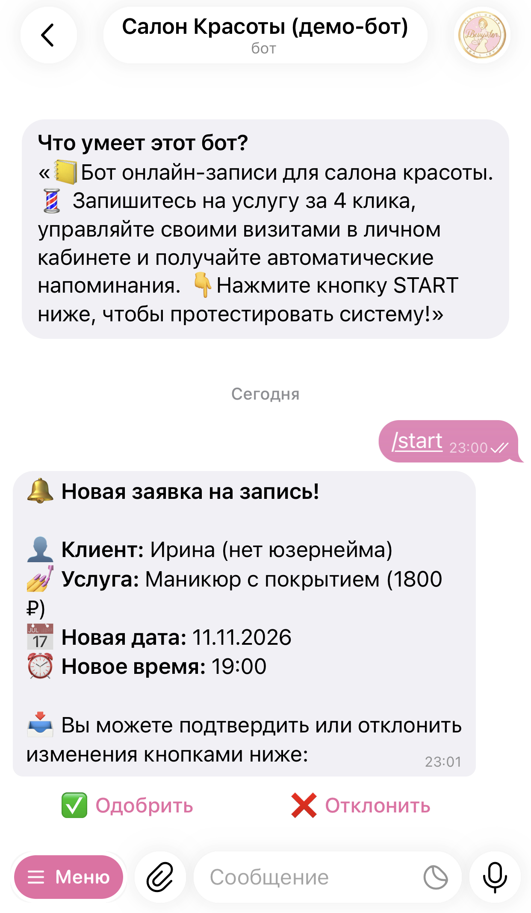

# Telegram-бот для записи в салон красоты

Бот для автоматизации онлайн-записи клиентов, управления расписанием и отправки напоминаний о визитах.

## Основной функционал

### Для клиентов
* **Запись на услуги:** пошаговый выбор услуги, даты и свободного времени с защитой от двойного бронирования и прошедших слотов.

<div align="center">
  
</div>

* **Управление записями:** просмотр актуальных визитов, перенос на другое время и отмена записи в один клик.

<div align="center">
  
</div>

### Для администратора
* **Управление заявками и расписанием:** мгновенные уведомления о новых записях с кнопками подтверждения или отклонения, просмотр расписания и выручки на сегодня.

<div align="center">
  
</div>

### Автоматизация
* **Напоминания о визитах:** проверка расписания раз в минуту и отправка уведомления клиенту за 2 часа до начала процедуры (по московскому времени).

## Стек технологий

* Node.js (v18+)
* grammY + `@grammyjs/conversations`
* SQLite (`better-sqlite3`)
* `node-cron`

## Структура проекта

```
├── images/                  # Скриншоты интерфейса
├── src/
│   ├── config/
│   │   └── database.js      # Подключение к SQLite
│   ├── conversations/
│   │   └── booking.js       # Сценарий записи
│                              и переноса визита
│   ├── handlers/
│   │   ├── admin.handlers.js  # Обработчики команд
│   │                          и кнопок администратора
│   │   └── client.handlers.js # Обработчики команд
│                              и меню клиента
│   ├── jobs/
│   │   └── reminder.cron.js   # Планировщик напоминаний
│   ├── models/
│   │   └── user.model.js      # Инициализация таблиц
│                              и начальных данных БД
│   └── index.js             # Точка входа
├── .env.example             # Шаблон переменных
│                            окружения
├── package.json
└── package-lock.json
```

## Установка и запуск

1. Установите зависимости:
```bash
npm install
```

2. Скопируйте файл `.env.example` в `.env` и заполните своими данными:
```env
NODE_ENV=production
DB_PATH=./src/database/beauty_salon.sqlite
TELEGRAM_BOT_TOKEN=ваш_токен_бота
ADMIN_TELEGRAM_ID=ваш_telegram_id
```

3. Запустите бота:
```bash
npm start
```
