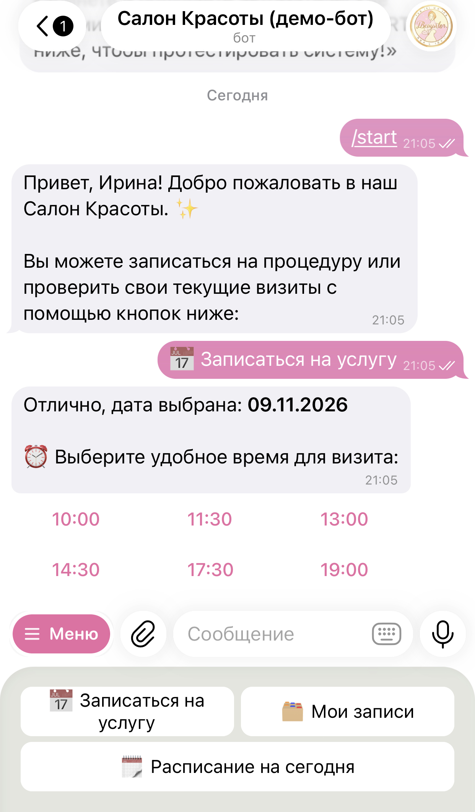
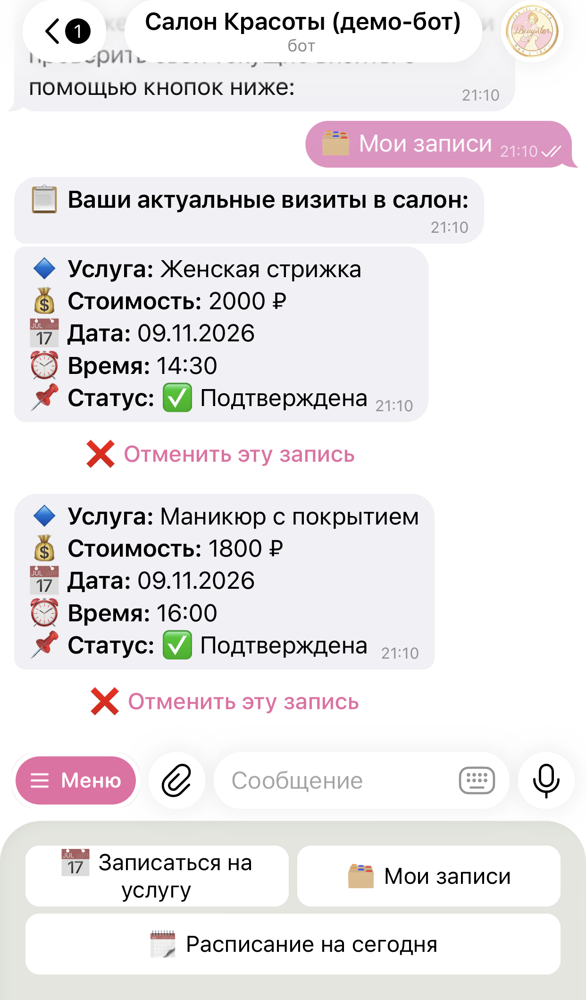

# 🤖 Telegram-бот для Салона Красоты (Node.js + grammY + SQLite)

Профессиональное Production-ready решение для автоматизации онлайн-записи, управления клиентами и контроля расписания салона красоты, барбершопа или студии маникюра.

Проект разработан на легковесном, асинхронном и ультрабыстром стеке, что позволяет запускать его на минимальных мощностях без просадки производительности и блокировок Event Loop.

---

## 🚀 Ключевые возможности системы

### 👤 Модуль Клиента
* **Умная пошаговая запись:** Реализована на базе стейт-менеджера `@grammyjs/conversations`. Защищена от текстового спама и ошибочных кликов по старым кнопкам из истории чата.
* **Динамическая сетка слотов (Инлайн-кнопки):** Бот в реальном времени анализирует занятые часы в базе данных SQLite и выводит клиенту только актуальное, свободное время (100% защита от «двойных записей»).

* **Защита от записи в прошлое:** Если клиент записывается «на сегодня», бот автоматически скрывает временные слоты, которые уже прошли.


* **Личный кабинет:** Клиент видит список всех своих будущих визитов с ценами, услугами и красивым  форматом дат (ДД.ММ.ГГГГ), а также может отменить визит в один клик.

### 👑 Модуль Администратора (CRM в кармане)
* **Мгновенные PUSH-уведомления:** В ту же секунду, как клиент нажимает финальную кнопку выбора времени, админу в чат прилетает детальная карточка заявки.
* **Инлайн-управление «на лету»:** Подтверждение (`confirmed`) или отклонение (`cancelled`) записи выполняется инлайн-кнопками прямо из сообщения-уведомления. 


*Инлайн-модерация поступающих заявок в чате администратора*

* **Обратная связь с клиентом:** При одобрении или отклонении заявки админом бот автоматически посылает клиенту мгновенное сервисное сообщение о смене статуса.

### ⏰ Модуль Автоматизации
* **Cron-напоминания:** Интегрирован планировщик задач `node-cron`. Каждую минуту скрипт бесшумно проверяет базу данных и ровно за 2 часа до визита отправляет клиенту напоминание: *«Ждем вас сегодня через 2 часа...»*.

---

## 🛠 Технологический стек

* **Runtime:** Node.js (v18+)
* **Framework:** grammY 
* **Database:** better-sqlite3 
* **Scheduler:** node-cron 

---

## 📂 Архитектурная структура проекта

```text
├── images/                  # Папка со скриншотами
│   ├── client.jpeg          # Скриншот интерфейса клиента
│   └── admin.jpeg           # Скриншот уведомлений админа
├── src/
│   ├── config/
│   │   └── database.js      
│   ├── conversations/
│   │   └── booking.js       
│   ├── models/
│   │   └── user.model.js    
│   └── index.js             
├── .env.example             
├── .gitignore 
├── package-lock.json            
├── package.json             
└── README.md                
```

---

## 🚀 Инструкция по развертыванию

### 1. Клонирование репозитория и установка dependencies
```bash
git clone https://github.com
cd beauty-salon-bot
npm install
```

### 2. Настройка окружения
Создайте в корне проекта файл `.env`:
```env
NODE_ENV=production
DB_PATH=./src/database/beauty_salon.sqlite
TELEGRAM_BOT_TOKEN=your_bot_token
ADMIN_TELEGRAM_ID=your_id
```

### 3. Запуск проекта
```bash
npm start
```
